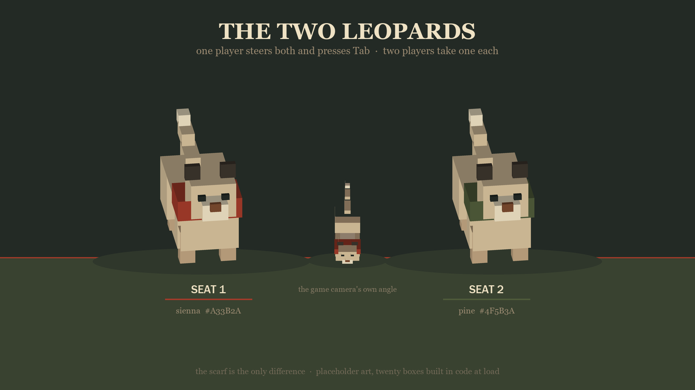

# High Hollow

A networked two-player co-op puzzle crawler, drawn like a 1970s national park poster. A pair of snow leopards works its way up a trail of levels, holding doors open for each other, fetching keys, and reaching each summit together.



This repository is the **Unity client**. The authoritative simulation is a Rust server that is still being built. Until it exists, a mock feed built into the client stands in for it, so the game is fully playable offline.

Current version: **v0.6.1** (see [Versioning](#versioning)).

## Requirements

- Unity **6000.6.0f1** (Unity 6) with the Universal Render Pipeline. Install that exact version from Unity Hub rather than letting a newer editor upgrade the project: an asset upgrade is one way, and the packages are pinned against this version.
- Input System package (the project uses the new Input System only)
- Newtonsoft JSON (`com.unity.nuget.newtonsoft-json`, installed through `Packages/manifest.json`)
- Nothing else. **Git LFS is not needed** and no plugins, DLLs or imported models are involved: every mesh, texture and material in the game is generated in code at load. The package list is deliberately short, so if a package appears that nothing here imports, it came from a template and can go.

## Getting started

1. Open the project folder in Unity Hub with 6000.6.0f1.
2. Open `Assets/Scenes/Crawler.unity`.
3. Press Play, then **Enter** on the title screen to set out.

By default the client runs against the mock feed and needs no server.

### Opening it on another machine

Clone the repository and open the clone. Do not copy `Library/`, `Temp/` or `Builds/` across: they are machine-specific, they are ignored for that reason, and Unity rebuilds `Library/` on the first open, which takes a few minutes.

If the first open fails, the cause is almost always outside the repository:

| Symptom | Cause | Fix |
| --- | --- | --- |
| Compile errors, or a package that will not resolve | The editor is not 6000.6.0f1 | Install 6000.6.0f1 in Unity Hub and open with it |
| A wall of package errors, or the resolve never finishes | No network on the first open, so the registry cannot be reached | Connect and reopen; packages are cached afterwards |
| A script or texture is a few lines of text starting with `version https://git-lfs` | Something was committed through LFS from a machine that had it installed | Install Git LFS and run `git lfs pull` |

The last row should never happen. `.gitattributes` carries the Unity template's long list of LFS file types, but the `lfs` macro is defined to mark those types binary **without** routing them through LFS, so a clone never needs LFS installed.

### Bootstrap settings

The `Bootstrap` object in the scene holds the switches you are likely to touch:

| Field | Default | What it does |
| --- | --- | --- |
| `useMockFeed` | on | Play against the built-in mock instead of a real server |
| `host`, `port` | `127.0.0.1`, `7777` | Server address when the mock is off |
| `playerName` | `snep` | Name sent in `hello` |
| `mockLevelId` | `foothills-1` | Level the mock starts on; the trail continues from there |
| `artStyle` | Placeholder | `Poster` for the finished look, `Placeholder` for fast testing |

The committed scene uses **Placeholder** art. Switch `artStyle` to **Poster** before a demo or a build.

## Controls

| Key | Action |
| --- | --- |
| WASD / arrow keys | Move (the last direction pressed wins) |
| Space | Interact with an adjacent lever or sightstone |
| Tab | Switch to your other leopard, when you hold both |
| Enter | Open chat, send a message |

## How the trail plays

The game is for **two leopards**. With a partner, each player steers one. Solo, or against the mock, one player holds both and presses **Tab** to switch; the leopard left behind stands exactly where it was, which is often the point: an idle leopard holds a plate open for the other.

The trail is a run of levels grouped into **biomes**, listed in `levels/trail.json`. Reaching a summit loads the next level. The first biome, **Foothills**, is built:

| Level | Teaches |
| --- | --- |
| Trailhead | levers and doors, then the first thing one leopard cannot do alone: a held plate and a lever on the far side |
| Stile Meadow | plates hold a door only while someone stands on them, so the pair takes turns |
| Cairn Fields | keys and the summit gate, pits, hidden pits, the sightstone and a false key; one key sits behind a door the partner has to hold |
| High Hollow | the finale: a hub with four rooms using all of the above |

Rules that apply everywhere:

- **Both leopards must reach the summit**: one on the marker, the other in the summit's room.
- **Falling into a pit** sends that leopard back to the entrance of the room it fell in, and every key it carries goes back where it was found. The partner and the room are untouched.
- **The summit gate** opens once the pair carries every key between them.

The rules live only in the mock today (`Assets/Crawler/Mock`); the full design, including the five biomes still to come, is in [docs/levels-design.md](docs/levels-design.md) and [docs/levels-plan.md](docs/levels-plan.md).

## Project layout

The client code lives in `Assets/Crawler`, split into assemblies so the layers cannot leak into each other:

| Assembly | Folder | Responsibility | Depends on |
| --- | --- | --- | --- |
| `Crawler.Protocol` | `Protocol/` | Message types, JSON codec, level format | Newtonsoft only (no UnityEngine) |
| `Crawler.Net` | `Net/` | TCP link: background reader thread, main-thread drain | Protocol (no UnityEngine) |
| `Crawler.Mock` | `Mock/` | Stand-in server with the demo rules | Protocol (no UnityEngine) |
| `Crawler.Render` | `Render/` | World view, entity views, terrain, procedural art, camera | Protocol |
| `Crawler.Input` | `Input/` | Samples input and sends it at the replication rate | Protocol, Input System |
| `Crawler.UI` | `UI/` | Chat, status badge, field guide, title and win posters, room banner | Render, uGUI, Input System |
| `Crawler.App` | `App/` | Bootstrap: picks the link and routes messages to the views | everything |
| `Crawler.EditorTools` | `EditorTools/` | Editor-only scene builder | Protocol, Render |

Other folders:

- `Assets/StreamingAssets/levels/`: level files, loaded at runtime.
- `Assets/Crawler/Generated/`: materials, textures and meshes written by the scene builder. Rebuilt on every run; do not edit by hand.
- `Assets/Crawler/Render/Resources/`: material templates that keep URP Lit in player builds.

### Principles

- **The client never simulates.** It renders state and captures input. There is no prediction, and no game rule lives in the client (the mock is the one deliberate exception, and it is isolated in its own assembly).
- **Snapshots replace, they do not patch.** Each snapshot replaces the whole replica. Each view's root snaps to its cell; any easing (gliding, facing, door sinks) happens on a child transform and is never read back.
- **The overlay is perception only.** Per-client hidden entities, substituted looks and phantoms are applied at render time and never written into the entity array, never into an input, and never into anything that will be hashed.

## Wire protocol

JSON Lines over TCP: one JSON object per line, discriminated by `t`.

**Client to server**

```json
{"t":"hello","name":"snep"}
{"t":"input","tick":412,"move":"n","interact":false}
{"t":"chat","from":0,"text":"on my way"}
```

`move` is one of `n`, `s`, `e`, `w`, `none`. Inputs are sent at the replication rate (20 Hz) and logged to the console. They move whichever leopard the client is steering.

```json
{"t":"control","seat":1}
```

A client holding both seats asks to steer the other leopard; the server answers with `seats`.

**Server to client**

```json
{"t":"welcome","client_id":0,"width":24,"height":9,"tick_hz":60,"replication_hz":20}
{"t":"seats","yours":[0,1],"active":0}
{"t":"snapshot","tick":412,"entities":[[15,9,0,0,-1]]}
{"t":"overlay","tick":412,"hidden":[7],"substituted":[[3,4]],"phantoms":[[26,21,4]]}
{"t":"chat","from":255,"text":"welcome to High Hollow"}
{"t":"level","id":"hollow"}
{"t":"round","tick":412,"state":"playing"}
```

An entity is `[x, y, kind, state, carried_by]`, where `carried_by` is `-1` when nobody carries it, else the seat carrying it. Its index in the array is its id; ids 0 and 1 are the two seats' leopards.

`seats` says which leopards this client controls and which it is steering; it is sent at the start and whenever control changes. Levels are rectangular, so `welcome` carries `width` and `height` (older servers sending a square `grid` are still accepted).

| Kind | Value | `state` |
| --- | --- | --- |
| Player | 0 | unused |
| Door | 1 | 1 = open |
| Lever | 2 | 1 = on |
| Plate | 3 | 1 = pressed |
| Key | 4 | unused |
| Hazard | 5 | unused |
| Goal | 6 | 1 = won |
| Sightstone | 7 | 1 = used |

Overlay entries are `substituted: [id, look]` and `phantoms: [x, y, look]`, where a look is an appearance key (the kind values above).

**Not yet agreed with the Rust server.** These are client-side conventions until the server settles them:

- Seat N is the Nth Player entity; the mock always gives its one client both seats.
- `level` and `round` are client additions to the original protocol.
- Chat from sender `255` is shown as the server.
- The overlay's look key was called `sprite` in early notes, from a 2D plan.

Canonical encoding and xxh3 hash parity with the server are planned, not implemented.

## Levels

Levels are JSON in `Assets/StreamingAssets/levels/{id}.json`: a name, a biome, a rectangular ASCII map (rows listed north to south), named regions with a rule, and optional links. Level ids are whitelisted to `[a-z0-9_-]{1,32}` because a server may send them. The order of play is `levels/trail.json`. Both files are part of the contract with the server.

| Glyph | Meaning | Glyph | Meaning |
| --- | --- | --- | --- |
| `.` | floor | `L` | lever |
| `#` | wall | `B` | plate |
| `T` | tree | `K` | key |
| `P` `1` | the two leopards' spawns | `k` | phantom key (perception only) |
| `D` | door | `H` | pit |
| `F` | summit gate | `h` | hidden pit |
| `G` | summit | `S` | sightstone |
| `E` | room entrance, where a fallen leopard returns | | |

A door takes its facing from the wall it stands in: walls to its east and west and the panel runs east to west, walls to its north and south and it turns a quarter turn. A door with no wall beside it at all has nothing to line up with and falls back to a fixed facing, so put doors in walls.

A door opens by its **links** if it has any: `"links": [{ "from": [col, row], "to": [col, row] }]`, written as column and row exactly as they read in `rows`, from a lever or plate to a door. A door with no links falls back to its region's rule: its region's plate in a `plate` region, its region's lever otherwise. The summit gate `F` opens when every key is carried.

### Tools

- `python tools/levelcheck.py <level.json>...` validates a level and **solves** it with the same rules as the mock: it reports the shortest winning route, how often control passes between the two leopards on it, and whether the level is **cooperative**. Every shipped level must solve.

  The cooperation check runs the search again with one leopard frozen at its spawn. If the other can still reach the summit on its own, having pulled every lever and picked up every key itself, the level is reported as `NOT COOPERATIVE`: nothing in it needs two players, and the only thing the partner contributes is standing at the summit at the end. A high hand-off count does not rule this out, because it only describes one shortest route and not what is possible.
- `python tools/build_foothills.py` regenerates the Foothills level files from code, where rooms, pieces and links are placed by coordinate rather than by hand-editing the map.
- `python tools/render_models.py` draws the model sheet at the top of this file, from the same box list and palette the game uses, for slides and documentation. It needs Pillow and does not need Unity.

## Editor tools

The **Crawler** menu in the editor:

- **Build Environment in Scene** (Ctrl+Shift+E): builds the level's terrain and a prop for every entity into the open scene, so it can be inspected without entering Play. Generated assets are written to `Assets/Crawler/Generated` so a saved scene keeps them. At runtime the static copy is cleared and rebuilt from the live feed, so it never duplicates.
- **Clear Environment from Scene**: removes what the builder added.
- **Art Style > Poster / Placeholder**: switches the style and rebuilds.
- **Next Level in Scene** (Ctrl+Shift+N): steps through the trail's levels.
- **Create Handmade Root**: makes the one child the builder will not touch. See below.

Both the level and the style come off the **Bootstrap component in the open scene**, the same two fields a play session reads, so the Scene view always shows what pressing Play would give. The menu writes to them. A scene with no Bootstrap in it falls back to an editor preference.

### What survives a play session

Pressing Play regenerates the world from the level file: `GridFloor` clears its own roots (`Tiles`, `Plinth`, `Apron`, `Walls`, `Trees`, `Scatter`, `ScenePreview`) and builds them again. **Anything you move, recolor or delete among those is discarded**, because the level file and the generators are the source of truth, not the scene.

The exception is a child named **`Handmade`**. Nothing generates it and nothing clears it, so its children appear in a play session exactly as you left them in the Scene view. Use it for one-off set dressing. Build Environment also moves any generated asset that a handmade prop references out of `Assets/Crawler/Generated` and into `Assets/Crawler/Handmade` before it wipes the generated folder, which keeps those references alive (a move preserves the asset's GUID).

So, to change the world: edit the level JSON for layout, the generators in `Assets/Crawler/Render` for how a thing looks, and the `Handmade` root for a single prop that exists nowhere else.

## Building

Build the standalone Windows player through **File > Build Profiles**, with `Assets/Scenes/Crawler.unity` as the only scene. Output under `Builds/` is gitignored. It also builds headless:

```bash
Unity.exe -batchmode -quit -projectPath "<project>" -buildTarget Win64 -buildWindows64Player "Builds/HighHollow/HighHollow.exe"
```

## Things that will bite you

- **Domain reload is off** (Enter Play Mode Options). Static fields survive between play sessions while the Unity objects they point at are destroyed, and a destroyed material renders magenta. Any static cache of Unity objects must reset in a `[RuntimeInitializeOnLoadMethod(SubsystemRegistration)]` method, and cache hits must use Unity's own null check, never `??` or `?.`. Test changes with two back-to-back play sessions.
- **Play mode only advances while the editor has focus**, so scripted checks run from outside the editor can stall at frame 2.
- **The project settings and package list are part of the repository.** `ProjectSettings/`, `Packages/manifest.json` and `Packages/packages-lock.json` are committed, so a change to the editor's own settings is a change to the project. Installing a package is a commit, and so is letting an editor of a different version rewrite the lock file.
- **The floor is one unbroken quad.** Nothing below y=0 is visible, and a face exactly on y=0 z-fights with it. Procedural bases sit slightly below zero for that reason.

## Versioning

The project follows [Semantic Versioning](https://semver.org). While it is below 1.0, new features bump the minor version, and fixes and small additions (documentation, tuning, content tweaks) bump the patch. **Every change that is pushed gets a version**, so the tag list doubles as a changelog. Releases are annotated git tags (`v0.1.0`, `v0.3.0`), and the player's version in Player Settings matches the latest tag. Commit messages follow [Conventional Commits](https://www.conventionalcommits.org) (`feat:`, `fix:` and so on), with Added / Changed / Fixed sections in the body.

| Version | Summary |
| --- | --- |
| v0.6.1 | The scarf is wide enough to tell the seats apart, and a renderer that draws the model sheet |
| v0.6.0 | The solver checks whether a level actually needs two leopards, and the two Foothills levels that did not now do |
| v0.5.0 | Doors face the wall they stand in; the placeholder leopard is built from boxes into a real silhouette with a wagging tail |
| v0.4.0 | The Scene view and Play share Bootstrap's level and art style; a `Handmade` root whose contents survive a rebuild |
| v0.3.1 | Portability fixes: the Hub bootstrap script and the unused template packages are gone, the LFS macro no longer routes files through LFS, and the README says how to open the project elsewhere |
| v0.3.0 | Two leopards with Tab switching, the Foothills biome (four levels), trail progression, rectangular levels with a scenery apron, room entrances, door links, the level solver |
| v0.2.1 | README; level design doc and the full 24-level plan |
| v0.2.0 | Procedural flat-shaded art, placeholder art style, editor scene builder, pits drop carried keys |
| v0.1.0 | First playable demo: hub and rooms, title and win posters, mock feed |
